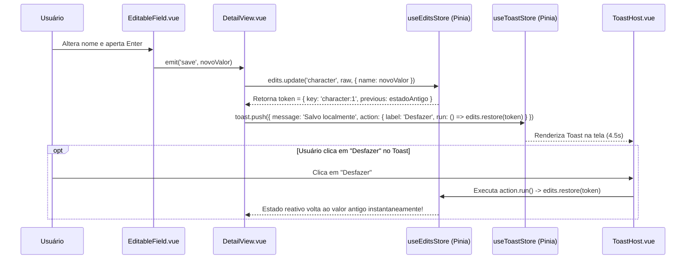

# Guia Completo e Passo a Passo (Código Comentado) — API REST, Pinia e Feedbacks

Este documento foi escrito para você entender **do zero e linha por linha** como as 3 partes principais do seu projeto funcionam:
1. **A Camada de API REST** ([`src/api/rickmorty.js`](./src/api/rickmorty.js))
2. **O Gerenciamento de Estado com Pinia e LocalStorage** ([`src/utils/storage.js`](./src/utils/storage.js), [`src/stores/edits.js`](./src/stores/edits.js), [`src/stores/favorites.js`](./src/stores/favorites.js))
3. **O Sistema de Feedbacks Visuais e Toasts com "Desfazer"** ([`src/stores/toast.js`](./src/stores/toast.js), [`ToastHost.vue`](./src/components/ToastHost.vue), [`EditableField.vue`](./src/components/EditableField.vue))

---

## PARTE 1: Como Pegamos os Dados da API REST (`src/api/rickmorty.js`)

### O que a API do Rick and Morty nos fornece?
A API REST tem a URL base `https://rickandmortyapi.com/api` e possui 3 recursos principais (`resource`):
- **`character`** (Personagens) → `https://rickandmortyapi.com/api/character`
- **`location`** (Locais) → `https://rickandmortyapi.com/api/location`
- **`episode`** (Episódios) → `https://rickandmortyapi.com/api/episode`

E cada recurso aceita **3 formatos de chamada REST**:
1. **Listar/Filtrar por página**: `GET /character?page=1&name=rick&status=Alive`
   - Retorna `{ info: { count: 826, pages: 42, next: "...", prev: null }, results: [ ...20 itens ] }`
   - **Detalhe importante da API**: quando você pesquisa um nome que não existe, a API **não** retorna uma lista vazia `[]` com status 200; ela retorna **erro HTTP 404** com `{ "error": "There is nothing here" }`.
2. **Buscar 1 item por ID**: `GET /character/1`
   - Retorna o objeto direto `{ id: 1, name: "Rick Sanchez", ... }`.
3. **Buscar vários itens por IDs separados por vírgula**: `GET /character/1,2,3`
   - Retorna um array `[ { id: 1, ... }, { id: 2, ... }, { id: 3, ... } ]`.
   - **Pegadinha da API**: se você chamar `/character/1,2` (dois IDs), ela devolve um **Array `[...]`**. Mas se a lista tiver só 1 ID (`/character/1`), ela devolve um **Objeto `{...}`**! Nosso código trata isso para nunca quebrar.

---

### Explicação Linha por Linha de [`src/api/rickmorty.js`](./src/api/rickmorty.js)

#### 1. Os 3 Caches em Memória (linhas 1 a 26)
```js
const BASE_URL = 'https://rickandmortyapi.com/api'
const cache = new Map()       // 1) Cache de URLs/Promises (ex: "/character?page=1")
const allCache = new Map()    // 2) Cache de listas completas (ex: todos os episódios)
const entityCache = {         // 3) Cache individual por ID (ex: character.get(1))
  character: new Map(),
  location: new Map(),
  episode: new Map(),
}
```
**Por que temos o `entityCache` e a função `storeEntities`?**
Imagine que o usuário abriu a lista de personagens (`Página 1`). A API devolveu os personagens de `id` 1 até 20.
A função `storeEntities(resource, data)` pega esses 20 personagens e guarda um por um dentro de `entityCache.character` (ID `1` → Rick, ID `2` → Morty...).
Quando o usuário clica no card do Rick para abrir a página de detalhes dele (`/characters/1`), a função `fetchOne('character', 1)` olha primeiro no `entityCache.character.get(1)`. Como o Rick **já está na memória**, a página abre **instantaneamente**, sem precisar fazer outra chamada na internet!

---

#### 2. Controle de Tempo Limite e Novas Tentativas (linhas 28 a 59)
```js
async function fetchWithTimeout(url, options = {}, timeoutMs = 10000) {
  const controller = new AbortController()
  const timeoutId = setTimeout(() => controller.abort(), timeoutMs)
  try {
    return await fetch(url, { ...options, signal: controller.signal })
  } finally {
    clearTimeout(timeoutId)
  }
}
```
- **O que é `AbortController`?** O `fetch` nativo do JavaScript não tem limite de tempo por padrão (se a internet travar, fica carregando para sempre). O `AbortController` cria um "sinal de cancelamento": se passar de 10 segundos (`10000ms`), o `setTimeout` chama `controller.abort()` e cancela a requisição.

```js
async function fetchWithRetry(url, options = {}, retries = 2, timeoutMs = 10000) {
  let lastError
  for (let i = 0; i <= retries; i++) {
    try {
      const res = await fetchWithTimeout(url, options, timeoutMs)
      if (res.status === 429 && i < retries) {
        const retryAfter = Number(res.headers.get('retry-after')) || 1
        await new Promise((r) => setTimeout(r, retryAfter * 1000 + 250 * (i + 1)))
        continue
      }
      return res
    } catch (err) {
      lastError = err
      if (i < retries) {
        await new Promise((resolve) => setTimeout(resolve, 350 * (i + 1)))
      }
    }
  }
  throw lastError
}
```
- **O que `fetchWithRetry` faz?** Tenta buscar a URL até 3 vezes (a tentativa inicial + 2 `retries`).
- Se a API responder `status === 429` (*Too Many Requests* — quando fazemos muitas chamadas rápidas), ele lê o cabeçalho `retry-after` que o servidor mandou, espera esse tempo e tenta de novo automaticamente.

---

#### 3. A Função Central `request(path)` (linhas 61 a 108)
```js
async function request(path) {
  if (cache.has(path)) return cache.get(path)
```
- **Detalhe de Sênior para falar na entrevista**: Nós guardamos no `cache` a **`Promise`** da requisição (`cache.set(path, promise)`), e não apenas o resultado final depois do `await`.
- **Por quê?** Porque se dois componentes na tela pedirem `/episode?page=1` no mesmo milissegundo, o segundo componente vê que `cache.has('/episode?page=1')` já é verdadeiro e reaproveita a mesma `Promise` que já está viajando pela rede! Isso evita requisições duplicadas.
- Dentro dela:
  1. Monta `candidateUrls = ['https://rickandmortyapi.com/api' + path, '/rm-api' + proxyPath]`.
  2. Tenta a URL oficial da REST API primeiro. Se uma extensão do navegador (como AdBlock) bloquear a palavra `/location`, o loop tenta automaticamente a segunda opção (`/rm-api/places`), que passa pelo proxy do Vite ([`vite.config.js`](./vite.config.js)).
  3. Se `res.status === 404`, retorna `null` (pois na API do Rick and Morty 404 significa "filtro sem resultados").
  4. Se `res.ok`, transforma em JSON (`await res.json()`), salva as entidades no `entityCache` via `storeEntities()` e retorna os dados.
  5. Se tudo falhar, faz `cache.delete(path)` (para não deixar uma Promise quebrada presa no cache) e lança o erro.

---

#### 4. As Funções que as Views Chamam (linhas 112 a 202)
- **`fetchPage(resource, page, filters)`**: Usa `new URLSearchParams` para montar a query string limpa (ignorando filtros vazios `''`). Se `request` retornar `null` (quando a busca deu 404), devolve `EMPTY_PAGE` (`{ info: { count: 0, pages: 0 }, results: [] }`).
- **`fetchOne(resource, id)`**: Olha primeiro no `entityCache[resource].get(numId)`. Se não achar, chama `request('/character/1')`.
- **`fetchMany(resource, ids)`**:
  - Filtra IDs repetidos com `new Set(...)`.
  - Descobre quais IDs **ainda não estão** no `entityCache` (`missing`).
  - Se houver IDs faltando, faz uma única chamada REST com vírgula: `request('/character/1,4,12')`.
  - Usa `Array.isArray(data) ? data : [data]` para garantir que mesmo quando `missing` tem apenas 1 ID, tratamos como lista.

---

## PARTE 2: Gerenciamento de Estados com Pinia e Persistência

### 2.1. Como salvamos no navegador? ([`src/utils/storage.js`](./src/utils/storage.js))

Vamos olhar cada bloco de [`src/utils/storage.js`](./src/utils/storage.js):

```js
export function usePersistedRef(key, fallback) {
  let initial = fallback
  try {
    const raw = localStorage.getItem(key)
    if (raw) initial = JSON.parse(raw)
  } catch (e) {
    void e
  }

  const state = ref(initial)
```
1. Quando o site abre, `usePersistedRef` vai no `localStorage` do navegador (usando a chave `key`, por exemplo `'rm-explorer:edits:v1'`) e lê o texto JSON salvo lá.
2. Se existir, converte de texto para objeto JavaScript com `JSON.parse(raw)`. Se não existir (primeira vez que o usuário abre o site), usa o valor padrão (`fallback`, ex: `{}` ou `[]`).
3. Cria uma variável reativa do Vue: `const state = ref(initial)`.

```js
  watch(
    state,
    (value) => {
      try {
        localStorage.setItem(key, JSON.stringify(value))
      } catch (e) {
        void e
      }
    },
    { deep: true },
  )
```
4. O `watch(..., { deep: true })` "vigiando" `state` em profundidade é o segredo: **toda vez que qualquer propriedade dentro de `state.value` muda no Pinia**, esse `watch` dispara sozinho e salva o novo JSON no `localStorage.setItem(...)`. Você nunca precisa lembrar de chamar uma função `salvarNoLocalStorage()` manualmente!

---

### 2.2. Como funciona a Store de Edições (`src/stores/edits.js`)?

Esta é a parte mais importante para você explicar na entrevista.
**O Problema**: A API do Rick and Morty é pública e aberta, então você **não pode** fazer um `PUT https://rickandmortyapi.com/api/character/1` para mudar o nome do Rick no banco de dados deles.
**A Solução**: Criamos uma store no Pinia ([`useEditsStore`](./src/stores/edits.js)) que funciona como uma **película transparente (Overlay)** por cima dos dados da API.

#### Como um registro editado fica salvo dentro de `records`?
Quando você edita o personagem de ID `1` (Rick Sanchez) e muda o nome dele para `"Rick C-137"` e o status para `"Dead"`, a store guarda exatamente isto dentro de `records.value["character:1"]`:

```json
{
  "resource": "character",
  "id": 1,
  "fields": {
    "name": "Rick C-137",
    "status": "Dead"
  },
  "base": {
    "id": 1,
    "name": "Rick Sanchez",
    "status": "Alive",
    "species": "Human",
    "gender": "Male"
  },
  "image": "https://rickandmortyapi.com/api/character/avatar/1.jpeg",
  "createdAt": 1730150000000,
  "updatedAt": 1730150050000
}
```
Repare que temos dois objetos dentro do registro:
- **`base`**: O retrato fiel de como o personagem veio da API antes de ser editado.
- **`fields`**: **Somente** os campos que o usuário modificou.

#### Como a função `edits.apply(resource, entity)` junta a API com o Pinia? (linhas 37 a 49)
Toda vez que uma tela recebe dados da API (`raw`), ela passa esses dados por `edits.apply('character', raw)`:
```js
  function apply(resource, entity) {
    if (!entity) return entity
    const rec = get(resource, entity.id)
    if (!rec) return { ...entity, _source: 'remote', _edited: [] }
    return {
      ...entity,
      ...rec.fields,
      _source: 'local',
      _edited: Object.keys(rec.fields),
      _original: rec.base,
      _updatedAt: rec.updatedAt,
    }
  }
```
Veja o que acontece aqui:
- **Se você nunca editou aquele personagem (`!rec`)**: ele devolve os dados da API com `_source: 'remote'` e `_edited: []`.
- **Se você já editou (`rec` existe)**: no JavaScript, quando fazemos `{ ...entity, ...rec.fields }`, as propriedades de `rec.fields` **sobrescrevem** as propriedades de `entity`! E ainda adicionamos:
  - `_source: 'local'` → faz aparecer o selo roxo **"Editado"** no card!
  - `_edited: ['name', 'status']` → diz para a tela quais campos específicos foram alterados para pintá-los de roxo!
  - `_original: rec.base` → permite mostrar na tela qual era o valor original da API riscado (`<s>Rick Sanchez</s>`).

#### O que acontece quando você salva uma edição em `edits.update()`? (linhas 66 a 106)
```js
    for (const [field, raw] of Object.entries(values)) {
      const value = normalize(raw)
      if (value === normalize(base[field])) {
        if (field in fields) {
          delete fields[field]
          changed.push(field)
        }
      } else if (fields[field] !== value) {
        fields[field] = value
        changed.push(field)
      }
    }
```
- Se você editar o nome do Rick de volta para `"Rick Sanchez"` (que é igual ao `base.name` original da API), o `if (value === normalize(base[field]))` percebe que o valor voltou ao original e faz `delete fields['name']`!
- E logo abaixo (linha 89): se não sobrar nenhum campo editado em `fields` (`!Object.keys(fields).length`), ele apaga o registro inteiro (`delete records.value[key]`) e o personagem volta a ser 100% remoto!

---

### 2.3. Como funciona a Store de Favoritos (`src/stores/favorites.js`)?

Na [`useFavoritesStore`](./src/stores/favorites.js):
- Guardamos um array simples de chaves no formato `"recurso:id"`, por exemplo: `["character:1", "location:3", "episode:10"]`.
- **Por que não salvar o objeto inteiro do personagem nos favoritos?**
  - Porque se você favoritar o Rick e depois editar o nome do Rick na store de edições, queremos que a tela de Favoritos busque os dados atualizados e aplique `edits.apply()`. Salvando apenas a chave `"character:1"`, ocupamos quase zero espaço no `localStorage` e nunca temos dados duplicados/desatualizados (*Single Source of Truth*).
- **`toggle(resource, id)` (linhas 69 a 76)**:
  - Procura `"character:1"` no array `items.value`.
  - Se já existe (`i >= 0`), remove com `splice(i, 1)` e retorna `false` (indicando que removeu).
  - Se não existe, adiciona no começo da lista com `unshift(key)` e retorna `true` (indicando que adicionou).

---

## PARTE 3: Sistema de Feedbacks Visuais e Toasts com "Desfazer" (Undo)

A aplicação dá **4 tipos de feedback imediato** para toda ação do usuário:



### 1. Como funciona o Toast com Botão "Desfazer"?
Olhe como [`DetailView.vue`](./src/views/DetailView.vue), [`useEditsStore`](./src/stores/edits.js) e [`useToastStore`](./src/stores/toast.js) trabalham juntos:

1. **Antes de salvar a alteração**, a `useEditsStore` tira uma cópia (clone) de como o registro estava antes:
   ```js
   const previous = clone(prev ?? null)
   // ... aplica a alteração ...
   return { key, previous } // Devolve esse "token de desfazer"
   ```
2. **Na `DetailView.vue`**:
   ```js
   function undoAction(token) {
     return { label: 'Desfazer', run: () => edits.restore(token) }
   }

   function onSave(field, value) {
     const token = edits.update(props.resource, raw.value, { [field.key]: value })
     if (!token) return
     toast.push({
       type: 'local',
       message: `“${field.label}” salvo localmente`,
       action: undoAction(token),
     })
   }
   ```
3. **Na `useToastStore` ([`src/stores/toast.js`](./src/stores/toast.js))**:
   - `toast.push(...)` coloca a notificação na lista `toasts.value` (mantendo no máximo 4 na tela) e agenda um `setTimeout` de `4500ms` (4,5 segundos) para sumir sozinha.
4. **No componente [`ToastHost.vue`](./src/components/ToastHost.vue)**:
   - Renderiza a mensagem e, se existir `t.action`, mostra o botão `<button @click="run(t)">Desfazer</button>`.
   - Quando clicado, chama `t.action.run()`, que executa `edits.restore(token)` — recolocando `token.previous` de volta no Pinia e fechando o Toast!

---

### 2. Feedback Visual nos Campos Editáveis ([`EditableField.vue`](./src/components/EditableField.vue))
Quando você está na página de um personagem:
- **Modo Visualização (`v-else`)**: Mostra o valor atual. Se a prop `edited` for `true`:
  - A caixa ganha borda roxa (`.efield.edited`) e mostra a tag `● editado`.
  - Aparece uma barra inferior (`.diff`) mostrando `<AppIcon name="cloud" /> Original: <s>{{ originalDisplay }}</s>` (o valor original da API riscado) ao lado do botão `restaurar`.
- **Modo Edição (`v-if="editing"`)**:
  - Ao clicar no campo, a função `start()` copia o valor atual para a variável temporária `draft`, muda `editing.value = true`, espera o Vue desenhar o `<input>` na tela usando `await nextTick()` e já coloca o cursor piscando com o texto selecionado (`inputEl.value?.focus()` e `select()`).

---

### 3. Feedback de Carregamento, Erro e Estado Vazio (UX)
Em todas as telas ([`HomeView.vue`](./src/views/HomeView.vue), [`ResourceListView.vue`](./src/views/ResourceListView.vue), [`DetailView.vue`](./src/views/DetailView.vue)):
- **Enquanto a API está respondendo (`loading === true`)**: Em vez de uma tela branca ou um spinner simples, exibimos o componente [`SkeletonGrid.vue`](./src/components/SkeletonGrid.vue), que imita o formato exato dos cards pulsando.
- **Se uma imagem falhar ou demorar ([`SafeImage.vue`](./src/components/SafeImage.vue))**: Enquanto a foto do personagem carrega da API, mostra um fundo gradiente gerado matematicamente pelo ID do personagem (`artFor(seed)`) e faz uma transição suave de opacidade quando a imagem termina de baixar (`@load`). Se a URL da imagem colocada pelo usuário na edição for inválida (`@error`), mostra um ícone de fallback sem aparecer aquele ícone de "imagem quebrada" do navegador.
- **Quando um filtro não encontra nada ou dá erro ([`EmptyState.vue`](./src/components/EmptyState.vue))**: Mostra um card temático com botão de ação imediata ("Limpar filtros" ou "Tentar novamente").

---

## Resumo Rápido ("Cola" para Falar na Entrevista)

Se pedirem para você resumir a arquitetura em 1 minuto:
1. **"Para consumir a API REST (`https://rickandmortyapi.com/api`)"**: Criei um módulo isolado em `src/api/rickmorty.js` com 5 funções (`fetchPage`, `fetchOne`, `fetchMany`, `fetchAll`, `fetchCount`). Implementei timeout com `AbortController`, retry automático para `HTTP 429` e **cache em memória por rota e por ID (`entityCache`)**, o que faz com que abrir um personagem que já apareceu na listagem seja instantâneo.
2. **"Para gerenciar estados com Pinia e salvar edições"**: Como a API é pública e somente leitura, criei a `useEditsStore` usando o padrão *Local Overlay*. Persistimos as alterações no `localStorage` de forma reativa com um composable próprio (`usePersistedRef` usando `watch` profundo). Guardamos o valor original da API em `base` e apenas os campos modificados em `fields`, mesclando tudo em tempo real com `edits.apply()`.
3. **"Para feedbacks ao usuário"**: Criamos o selo visual `SourceBadge` ("Editado"), comparação *diff* mostrando o valor original riscado com opção de restaurar campo a campo, Skeletons durante o carregamento e a `useToastStore`, que recebe um *token* com o estado anterior a cada edição e permite **Desfazer (Undo)** qualquer mudança com 1 clique.

